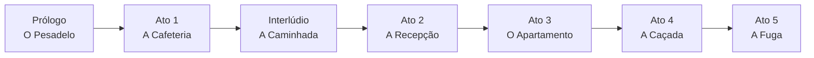

# The Delivery — Mapa do Jogo

Terror em primeira pessoa (Unity 6 · URP · PC). A protagonista é a [[Personagens#Clear|Clear]].
Pilares: **terror cotidiano**, **tensão constante**, **inevitabilidade trágica**, **violência mínima** e **voz interna em texto** (sem dublagem da protagonista).

> [!tip] Visão gráfica
> Abra o [[Mapa das Mecânicas.canvas|canvas do mapa]] para ver a linha da história e como os sistemas se ligam.

## Linha da história

## Registro de atos
| Ordem | Ato | Cena (.unity) | Enum `GameAct` | Diretor | Status |
|---|---|---|---|---|---|
| 0 | [[Prólogo - O Pesadelo]] | Nightmare | `ActNightmare = 6` | NightmareDirector | jogável |
| 1 | [[Ato 1 - A Cafeteria]] | Cafeteria | `Act1 = 1` | Act1Director | jogável |
| 2 | [[Interlúdio - A Caminhada]] | Road | `ActJourney = 5` | JourneyDirector | jogável |
| 3 | [[Ato 2 - A Recepção]] | Reception | `Act2 = 2` | Act2Director | jogável |
| 4 | [[Ato 3 - O Apartamento]] | Apartment | `Act3 = 3` | Act3Director | jogável |
| 5 | [[Ato 4 - A Caçada]] | Apartment | `Act4 = 4` | Act4Director | jogável |
| 6 | [[Ato 5 - A Fuga]] | Escape | `ActEscape = 7` | Act5Director | jogável |

## Mecânica principal e lore por ato
| Ato | Mecânica principal | A história em uma linha |
|---|---|---|
| [[Prólogo - O Pesadelo\|Prólogo]] | **A corrida** | No sonho, uma criatura a persegue num corredor sem saída, a ergue pelo pescoço e a arremessa no abismo |
| [[Ato 1 - A Cafeteria\|Ato 1]] | **A conversa** (sentar e conversar) | Ela acorda na cafeteria, conversa com a Marina sobre a prova e decide ir para casa |
| [[Interlúdio - A Caminhada\|Interlúdio]] | **A caminhada** (perda de controle no encontro) | A cidade se apaga no caminho, e um estranho avisa que "sempre começa igual" e que ela vai poder escolher |
| [[Ato 2 - A Recepção\|Ato 2]] | **Investigação** | O porteiro sumiu, e o zelador Jef a chama pelo nome, que ela nunca disse |
| [[Ato 3 - O Apartamento\|Ato 3]] | **Interagir com a casa** | O entregador sabe onde ela mora; campainha, ligação muda, vizinho hostil, e ele a encara da rua |
| [[Ato 4 - A Caçada\|Ato 4]] | **Esconder-se** (com o microfone) | Ele está dentro de casa; o celular morre, a ligação cai, ela se esconde no box e é emboscada e levada |
| [[Ato 5 - A Fuga\|Ato 5]] | **Ligar 5 geradores no breu** (só a lanterna do celular) | Presa numa cela num navio naufragado, ela pega a chave, liga os geradores e foge; o Lenin a caça do 3º gerador em diante e, no fim, só fica olhando: "Continua..." |

> [!question] Fios em aberto da lore
> - Quem é o Leaning, e quem é o "ele" que "não gosta que eu demore"?
> - Qual é a **escolha** que o Leaning promete? Nenhuma mecânica do jogo a entrega claramente ainda.
> - O que aconteceu com o Seu Jorge, e como o Jef sabia o nome da Clear?
> - O pesadelo é uma premonição? A criatura a pega e a leva, como o killer faz no Ato 4.
> - Na Fuga: **o Lenin é o sequestrador**. Por que ele a prendeu num navio naufragado, e por que não a segue no fim ("...Por que ele não vem?")? É o gancho do Ato 6.
> - O Lenin e o killer do Ato 4 são a mesma pessoa, ou trabalham juntos?

O número do enum **não** é a ordem da história: ele é fixo por causa da serialização. A ordem fica no `GameActCatalog`. Um ato novo ganha o próximo número livre (**8**). Ver [[Máquina de beats]].

## Mecânicas
**Jogador**
- [[Movimento em primeira pessoa]] — andar, correr, agachar, espiar (Q/E)
- [[Fôlego (estamina)]] — corrida limitada e persistente entre cenas
- [[Lanterna do celular]] — a única luz dela no navio escuro (Ato 5)
- [[Interação]] — mirar e apertar **F**; objetos "armados" pelo roteiro
- [[Corpo em primeira pessoa]] — corpo e sombra da Clear visíveis

**Furtividade e caçada**
- [[Ruído e audição]] — o barulho que ela faz atravessa paredes
- [[Esconderijos]] — guarda-roupa, cama, sofá, box, contêiner
- [[Microfone no esconderijo]] — a voz real do jogador denuncia a Clear
- [[IA do antagonista]] — patrulha → suspeita → busca → perseguição → ataque
- [[Captura e Game Over]] — "VOCÊ MORREU" e de volta ao menu

**Narrativa**
- [[Máquina de beats]] — como cada ato é conduzido
- [[Pensamentos (voz interna)]] — a voz da Clear em texto
- [[Diálogos (legendas)]] — falas dos outros personagens
- [[Inventário e itens]]
- [[Geradores e portão]] — o objetivo do Ato 5: 5 geradores, em qualquer ordem

**Estrutura**
- [[Save, checkpoints e seleção de atos]]
- [[Menus (início e pausa)]]

**Ambiente**
- [[Anoitecer e toque de recolher]]
- [[Música e ambiente sonoro]]
- [[Chuva]]
- [[Tratamento visual (VHS e visão turva)]]

## Matriz ato × mecânica
● = central no ato · ○ = presente, mas secundário

| Mecânica | Prólogo | Ato 1 | Interlúdio | Ato 2 | Ato 3 | Ato 4 | Ato 5 |
|---|:-:|:-:|:-:|:-:|:-:|:-:|:-:|
| Movimento | ● | ○ | ● | ○ | ○ | ● | ● |
| Fôlego / corrida | ● |  |  |  |  | ● | ● |
| Interação (F) |  | ● |  | ● | ● | ● | ● |
| Pensamentos | ● | ● | ● | ● | ● | ● | ● |
| Diálogos |  | ● | ● | ● | ● | ● |  |
| Inventário |  |  |  |  | ● | ○ | ● |
| Ruído e audição |  |  |  |  |  | ● | ● |
| Esconderijos |  |  |  |  |  | ● | ● |
| Microfone |  |  |  |  |  | ● |  |
| IA do antagonista |  |  |  |  |  | ● | ● |
| Captura / Game Over | ○ |  |  |  |  | ● | ● |
| Cutscene dirigida | ● | ○ | ● | ● | ● | ● | ○ |
| Lanterna do celular |  |  |  |  |  |  | ● |
| Geradores e portão |  |  |  |  |  |  | ● |
| Ambiente dinâmico | ● | ○ | ● |  | ● | ● |  |

No Prólogo a "captura" é o ataque em tela cheia da criatura, que leva ao mesmo corte da queda (não há Game Over).

## Personagens
Ver [[Personagens]].

## Como registrar um ato novo
1. Criar a nota em `Atos/` a partir do [[Modelo - Ato]].
2. Adicionar a linha na tabela **Registro de atos** e a coluna na **Matriz**.
3. Ligar o ato anterior e o próximo (`anterior`/`proximo` nas propriedades).
4. Adicionar o cartão do ato no [[Mapa das Mecânicas.canvas|canvas]].
5. Se o ato trouxer uma mecânica nova, criar a nota dela em `Mecânicas/` e ligá-la aqui.
