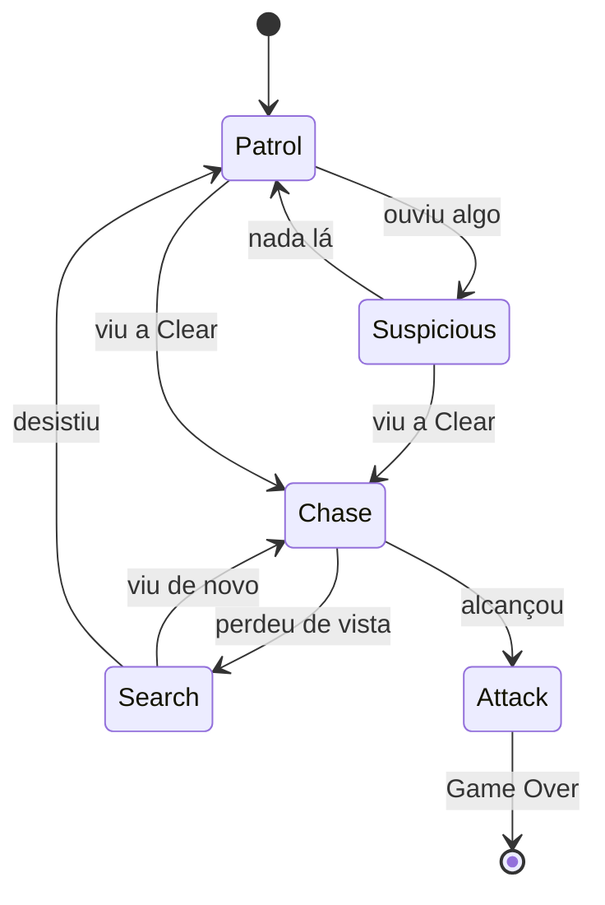

# IA do antagonista

Uma máquina de estados (FSM) que transforma "o que os sensores percebem" em "o que ele faz", andando com o `NavMeshAgent`.

| Estado | O que faz | Velocidade padrão |
|---|---|---|
| **Patrol** | Percorre os pontos da rota em loop, parando um tempo aleatório em cada | 2,0 m/s |
| **Suspicious** | Vai até a fonte do som e olha (3 s) | 2,5 m/s |
| **Search** | Procura perto da última posição conhecida (raio de 4 m, por 8 s) | — |
| **Chase** | Persegue vendo a Clear; lembra dela por mais 4 s depois de perder de vista | **3,5 m/s** |
| **Attack** | Alcançou (1,5 m) e dispara `PlayerCaught` | — |

## Sensores
- **Visão** (`AIVision`): cone de 60°, alcance de 8 m, linha de visão, e ignora a Clear escondida. **A visão tem prioridade sobre a audição.**
- **Audição** (`AIHearing`): ver [[Ruído e audição]].
- Esconder-se sendo visto avisa a FSM (`OnPlayerHidWhileSeen`), e ele caça direto o esconderijo. Ver [[Esconderijos]].
- [[Microfone no esconderijo]]: a FSM assina o aviso de barulho crítico.

## Controle pelo roteiro
O diretor do ato pode **suspender** a FSM (cutscenes, o final no box) e **retomar** (`ResumeFromDirector`). No [[Ato 4 - A Caçada]] ele começa desligado e é ativado no beat `Discovery`.

> [!important] Design
> Ele é **mais rápido que a corrida dela** (3,5 contra 3,2 m/s). Fugir só compra tempo; a saída é se esconder.

## Onde aparece
- [[Ato 4 - A Caçada]]: o killer.
- [[Ato 5 - A Fuga]]: o sequestrador (uma cópia com os mesmos valores).
- **Não** é usada no [[Prólogo - O Pesadelo]]: lá a criatura é coreografia.
