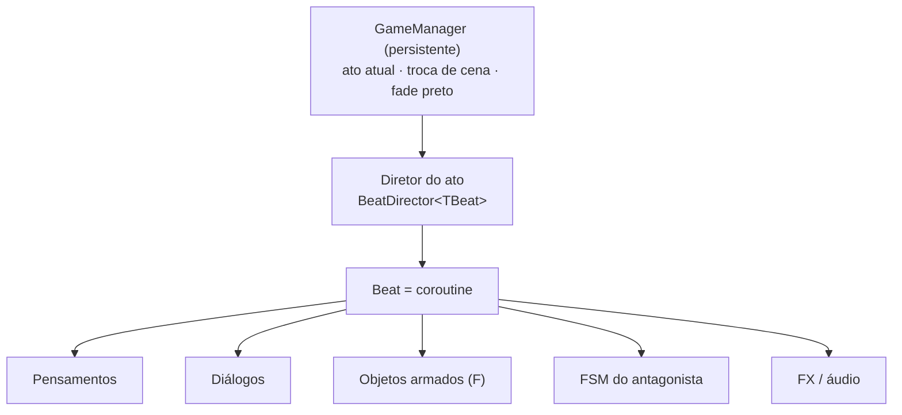

# Máquina de beats

Cada ato é conduzido por um **diretor** ("maestro") que herda de `BeatDirector<TBeat>`. Cada beat é **uma coroutine**, e o avanço é explícito (`AdvanceToBeat`).

## Camadas

- **GameManager**: sabe só o **ato** atual, carrega cenas e cobre a troca com uma tela preta. Não conhece beats.
- **Diretor**: só diz qual coroutine roda em cada beat (`CreateBeatRoutine`) e o que limpar na troca (`OnBeatExit`).
- **Cada beat garante sozinho o estado de que precisa** (player travado ou livre, objetos ativos). É isso que torna seguro pular direto para um beat do meio.

## Regras
- Enums com **valores explícitos**: `None = 0` e os beats em ordem cronológica. Um valor novo ganha o próximo número livre.
- **Teclas 1–9** pulam para o 1º–9º beat (debug), e `startBeat` no Inspector escolhe onde começar.
- Um diretor só roda se `GameManager.CurrentAct` for o seu ato (ou com `autoStartForDebug`).
- `EnsurePlayerFree`: evita herdar uma trava de movimento da cena anterior.
- Classe grande vira partial por assunto (ex.: `NightmareDirector.Grab.cs`), com todos os campos no arquivo principal.

## Ordem dos atos
O número do `GameAct` é estável; a **ordem da história** fica no `GameActCatalog`. A progressão é linear: cada ato libera o próximo. Ver [[00 Mapa do Jogo#Registro de atos]].

## Diretores
| Diretor | Ato |
|---|---|
| NightmareDirector | [[Prólogo - O Pesadelo]] |
| Act1Director | [[Ato 1 - A Cafeteria]] |
| JourneyDirector | [[Interlúdio - A Caminhada]] |
| Act2Director | [[Ato 2 - A Recepção]] |
| Act3Director | [[Ato 3 - O Apartamento]] |
| Act4Director | [[Ato 4 - A Caçada]] |
| — | [[Ato 5 - A Fuga]] (pendente) |

Conecta com [[Save, checkpoints e seleção de atos]]: o save guarda o beat, e o diretor retoma por ele.
